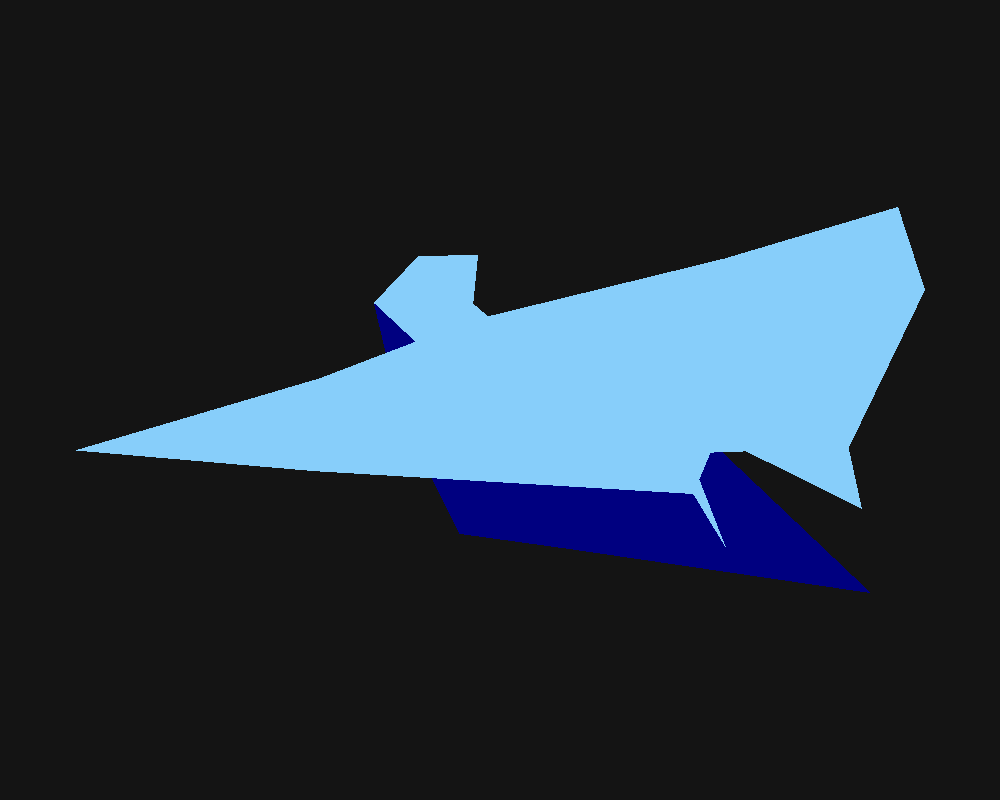

# Software Renderer - Nave

Primer ejercicio del Proyecto 1: se carga un modelo `.obj` hecho en Blender y se dibuja
en pantalla pintando cada triángulo con una función propia.
Hecho en Rust.



## Cómo funciona
1. `src/obj.rs` lee el `.obj`: guarda los vértices (`v`) y los índices de las caras (`f`).
2. `src/main.rs` recorre las caras de 3 en 3 índices, toma esos tres vértices y los manda a `triangle()`.
3. `src/triangle.rs` rellena cada triángulo en el framebuffer (con z-buffer para que lo de atrás no tape lo de adelante).
4. El modelo se gira, se centra y se escala para que quede en el centro de la ventana.
5. Colores: celeste para la parte de arriba de la nave y azul marino para la de abajo.

## Ejecutar
```
cargo run --release
```
Se abre una ventana con la nave. Con la tecla **S** se guarda la imagen como `render.png`.

Si raylib no compila, no abre ventana y solo guarda `render.png`:
```
cargo run --release --no-default-features
```
